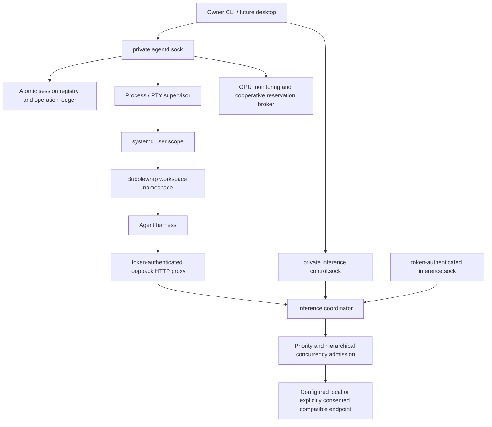

# Person 3 runtime architecture

Implementation status: experimental development runtime. The weekly plan remains
unchanged. Task acceptance is tracked separately in `docs/roadmap/person3-tasks.md`.

## Existing architecture study (P3-001)

`cerynthd` owns scheduler supervision and exposes newline-delimited JSON through
`cerynth-ipc`. Its request/response envelopes, profile/backend enums, heartbeat
validation, and process cleanup are shared with `cerynthctl`. `cerynth-config`
loads TOML configuration and persists the low-level runtime state. Invalid
configuration currently falls back to defaults with diagnostics. The agent
runtime does not reuse that permissive configuration behavior for authorization:
unknown session fields, corrupt state, and unsupported API versions fail closed.

`cerynth-telemetry` samples `/proc` and `/sys`, computes interval CPU utilization,
and records machine/scheduler snapshots. It does not establish semantic agent
states. The agent runtime combines explicit lifecycle events with process start
ticks, boot identity, descendant observations, and adapter-reported events.

The existing frozen scheduler socket, state paths, heartbeat schema, and
optimization policy are unchanged. The branch includes upstream main through
`6a6f0183216eb609e2d0f5acda89b0ec61a41a64`, including its executable-bit fixes.
Person 3 adds no scheduler source changes.

## Runtime boundaries

The owner control sockets are not mounted into a sandbox. Same-user Unix peer
credentials authenticate desktop control; they are not a per-agent identity.
Unisolated development sessions explicitly lose that protection and require a
daemon startup opt-in. No ambient API keys, host home directory, or shell
environment are passed to launched agents.

The inference data socket and HTTP proxy accept a random per-session credential and an
owner-configured model allowlist, endpoint, trust domain, maximum priority, and
hierarchical concurrency scopes. Data requests cannot register endpoints, mint
credentials, change budgets, or unload models. Revocation cancels queued/client
requests; an engine may continue computation after disconnect.

OpenCode, Codex and Hermes launch plans bind to the proxy using a narrowly scoped
token. Current HTTP access requires explicitly enabled host networking. HTTP
routes preserve messages/tools, enforce bounded stateless inference, and retain
admission leases until streaming completion, cancellation or deadline. Session,
ancestor and owner-configured project limits all apply through the coordinator.

Routing and backend-origin trust-domain bindings persist without credential
values. Session access tokens do not survive coordinator restart. Different
trust domains are rejected on the same backend origin, including endpoint
aliases and reassignment after revocation. This is conservative routing policy;
it is not proof that two independently configured remote origins share no
engine-side cache. Operators remain responsible for actual backend separation.

## Process and workspace ownership

Each owned process has a UUID session, operation ID, request fingerprint, PID,
process-group identity, boot ID, start tick, allocation ID, and optional scope
unit. Duplicate operation IDs return existing evidence and do not reexecute;
changed details under the same ID are rejected. Unknown completion after a
crash remains unknown; retries do not replay external effects automatically.
The launch ledger does not deduplicate arbitrary tools inside an external
harness; those require Person 2's authoritative tool broker.

Default process launching requires Bubblewrap and a systemd user scope. The
sandbox exposes `/usr` read-only, one writable workspace, private `/tmp`, a new
home, process/user/IPC/UTS namespaces, and either denied networking or explicitly
requested host networking. A network-enabled session does not receive domain
filtering. GPU device nodes are not automatically passed into this profile.
The optional Guard path uses Person 2's actual profile and seccomp launcher;
the default Bubblewrap path does not acquire those controls. Credential issuance
and native-harness inference through Guard remain unfinished integrations.
Namespace isolation is not a full security review.

Scopes receive CPUWeight, MemoryHigh, MemoryMax, TasksMax, and control-group kill
semantics. Parent/child creation bounds child reservations and capabilities.
Parent CPU weight is not a sum of CPU capacity; nested kernel-enforced parent
cgroup totals require Person 1's resource API. Current scopes are independent
user-manager scopes, so hierarchical reservation validation must not be labelled
hierarchical kernel enforcement.

Distinct active processes cannot use overlapping writable workspaces. An owner
can create separate Git worktrees before starting agents. Worktrees and branches
are retained for review, never force-deleted or automatically merged. Registration
uses fixed Git metadata operations with hooks, fsmonitor and fetching disabled.
Checkout runs in a separate network-denied Bubblewrap/systemd scope, with the
common object database read-only and only that worktree's index metadata writable.
The trusted checkout helper disables repository-defined clean/smudge/process
filters. A durable preparing record prevents a restart from silently launching
the original workspace after interrupted preparation. Worktree mutation currently
serializes launch admission for up to its bounded checkout deadline (30 seconds).
Full Git
operations inside isolated worktrees may need a reviewed narrow mount of Git
metadata; the runtime does not expose the entire original checkout to solve it.

Artifact collection anchors `openat2` at the workspace directory, rejects
symlink/traversal paths, hashes bounded content, and stores an immutable private
snapshot. File, diff, test-result, and task-result kinds label evidence; the
runtime does not infer a passing test from a filename or harness exit code.

## Events and recovery

Lifecycle events have monotonic per-session sequence numbers, wall timestamps,
and stable event IDs. The owner can poll events after a cursor. Tool and usage
records are normalized from supported JSONL shapes without copying raw commands,
prompts, reasoning, or tool outputs into audit events. Adapter-reported evidence
is labelled `harness_report`, distinct from runtime-observed process evidence.
Raw terminal output is a private, bounded output artifact, not a system log.

Graceful shutdown signals active processes, stops owned scope units, drains
workers, records outcomes, and removes sockets. Restart cleanup checks boot/start
identity before signalling old process groups and requests shutdown of the
session's uniquely named scope. Terminal records with pending cleanup are also
recovered. Parent exit cancels descendants. Observed sessions never acquire kill authority.
Managed launch payloads arm `setpriv --pdeathsig KILL` before checking the original
supervisor PID. A late child cannot begin the payload after daemon death. This
complements scope recovery rather than replacing process-generation checks.
This does not provide transparent harness resume, external-action rollback, or
remote process recovery.

## Guard integration at a pinned revision

`origin/feat/guard-sandbox` supplies a real Person 2 API at
`e592fa47797179ad24a99fc76143be48191a7649`. The optional owner setting
`CERYNTH_GUARD_SOCKET` connects to that protocol without merging its source or
changing its contract. `runtime.guard` explicitly selects Guard; any registration,
profile or transport failure fails the launch, with no weaker fallback.

The implemented slice supports offline `generic_pty` commands. The runtime
registers the same session/parent UUIDs, requests a launch profile, records its
digest, and runs its argv in an owned systemd scope. Guard evaluates child
capability inheritance. Management directories are excluded from filesystem
grants. Authorization cleanup follows verified process cleanup, ending children
before parents. Ambiguous registration/cleanup remains pending and blocks archival;
`cleanup UUID` retries it. A real pinned-Guard smoke test verifies workspace access,
host-file/network/approval isolation, seccomp, child-escalation denial and cleanup.

Native inference through Guard is not implemented. The existing gateway strips
agent authorization headers; passing a coordinator token in ordinary agent
configuration therefore cannot establish the intended trusted identity. The
[handoff proposal](guard-inference-handoff.md) specifies the remaining credential
binding and integration tests. It is a proposal, not a team agreement.

All CLI adapters now implement the same capability-negotiated preparation trait;
the [adapter decision record](adr-agent-adapter-ownership.md) explains why the
supervisor owns execution and security rather than duplicating them in plugins.

## Cross-track review requests (P3-010, P3-019, P3-020, P3-021)

These are proposed handoffs, not claims of agreement:

| Owner | Needed interface | Required evidence |
| --- | --- | --- |
| Person 1 | Reserve/release allocation by session and parent, create hierarchical cgroups, pressure stream | Effective limits, cgroup identity, failures, authoritative accounting |
| Person 2 | Authorize immutable launch/tool action, issue scoped credentials, provide sandbox receipt | Principal, policy version, exact action hash, expiry, enforced boundary |
| Person 4 | Consume versioned events and resource observations | Cursor/gap handling, source/provenance, unavailable metrics, true enforcement labels |

Person 1's shared allocation/pressure API and Person 4's consumer are not present
in this checkout. Person 2's pinned branch is integrated for the offline slice
described above; native inference and authoritative tool-effect deduplication
remain incomplete. No messages were sent to teammates and no review or approval
has been fabricated.
