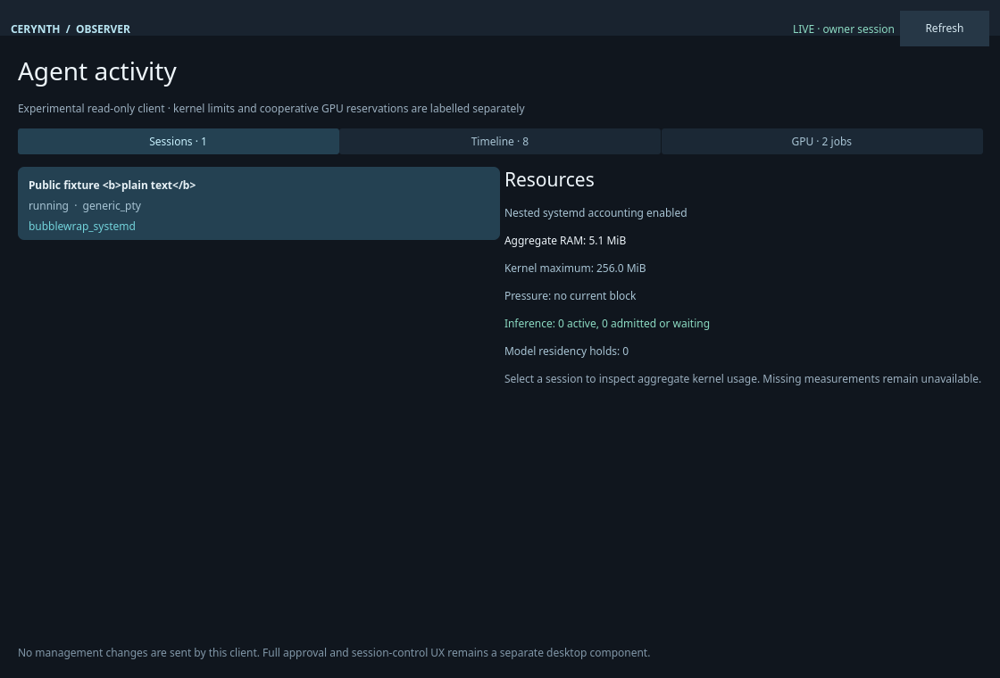

# Native runtime observer

`apps/cerynth-observer` is a small Qt 6/QML desktop client for the implemented
Person 3 runtime. It provides a working integration surface for Person 4, with
session state/boundaries, cursor events and provenance, aggregate CPU/RAM
accounting, cooperative GPU admissions, pressure and inference activity.
It is read only. It does not implement approvals, terminal emulation or the
complete desktop shell.



Build with Qt 6.6 or later, including Quick, QuickControls2, Network and Concurrent:

```bash
cmake -S apps/cerynth-observer -B artifacts/person3/observer-build -G Ninja
cmake --build artifacts/person3/observer-build -j2
artifacts/person3/observer-build/cerynth-observer \
  --agent-directory "$HOME/.local/state/cerynth/agentd" \
  --inference-directory "$HOME/.local/state/cerynth/inferenced"
```

The fixture was built with Qt 6.12.0. Socket requests run off the UI thread,
verify peer UID and private socket permissions, and use bounded request/response
sizes and deadlines. The client sends a fixed set of read operations. Lower-trust
labels use plain text. Retention gaps, bounded event views, stale snapshots and
unavailable measurements remain visible. No raw credential or approval payload
is required by the view.

Reproduce the actual owner-API fixture and the bounded contention measurement:

```bash
python3 tools/observer_runtime_smoke.py
python3 tools/resource_responsiveness_smoke.py
```

The first uses real daemons, systemd accounting, GPU reservations and a public
synthetic backend. Its exported screenshot is an integration demonstration, not
an LLM-performance measurement. The second runs two half-core child workloads
under one parent core, measures owner IPC and Qt software offscreen rendering,
and records all frame intervals. It does not measure physical KWin input latency.
Both need user systemd, Bubblewrap and the described NVIDIA fixture hardware.

For manual local capture, optional `--snapshot-json`, `--capture`,
`--select-session UUID` and `--exit-after-ms 4500` make a bounded reviewable demo.
`--frame-metrics PATH` additionally requests synthetic 16 ms repaint observations;
it requires a bounded duration. Exported files can contain the viewed session's
metadata; the automated fixture uses public synthetic data only.

Stage the binary/desktop entry alongside the Rust runtime without enabling services:

```bash
scripts/install-agent-runtime.sh --root /absolute/staging-root --profile debug \
  --observer-build artifacts/person3/observer-build
```

`tools/packaging_runtime_smoke.py` stages the exact binaries and user units,
starts isolated runtime-linked copies with unique state/ports, forces a daemon
crash, verifies systemd restart and session recovery, then removes its test units.
It does not install or enable production units or claim a booted distribution image.

See the [resource handoff](../contracts/resource-admission-v1alpha1.md) and
[validation evidence](../integration/2026-11-12-person3-local-completion.md).
